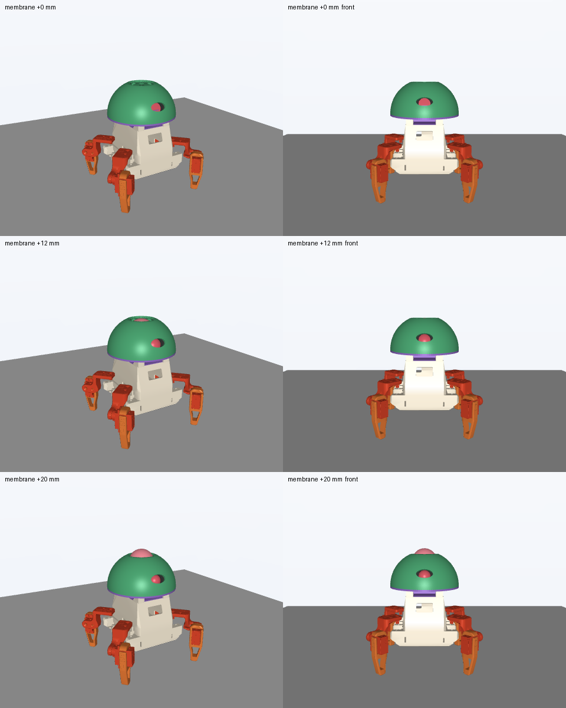

# 呼吸するドーム（Ø100 試作）— breath-dome v1

V3機体（`reference/frame-and-cover_261105`）の頭部の蓋に載せる、直径100 mmの試作ドームです。
天頂の**膜**が空気でふくらんでしぼみ、正面の**口**（切れ目の入ったシリコンの唇）から息が漏れます。
それによって呼吸しているように見せます。「浸透する身体」構想（環境 → 生理状態 → 外から見える症状）の、最初の出力器官です。



> **元の要件（自己復帰）は満たしません。机上の試作専用です**（`REQUIREMENTS.md` の C1〜C4、E5）。CADと幾何チェックまで完了（`build/breath-report.json`、全項目合格）。印刷・空気漏れ・膜の挙動は未確認です。
> このドームは小さいので**自己復帰はしません**。自己復帰には直径約180 mmが必要です（`README.md`）。

## 仕組み

```
ポンプ／注射器 ─ チューブ（後ろの縁の切り欠きから出る）─ T字継手 ┬─ 肺カプセル → 天頂の膜がふくらむ
                                                               └─ 口カプセル → 唇がふくらみ、切れ目が開いて息が漏れる
```

- **吸う（ふくらむ）**：空気を送ると膜が持ち上がり、天頂の穴（Ø40）からせり出します。膜は穴の縁より12 mm奥にあるので、
  12 mmまでは「穴の奥で動く」、それ以上で「外へ盛り上がる」見え方になります。
- **吐く（しぼむ）**：送るのを止めると、口の切れ目から空気が抜けます。唇が震え、膜がゆっくり沈みます。
  弁を使わずに、自然に息を吐く動きになります。切れ目の長さで吐く速さが変わります。

| 膜の盛り上がり h（Ø36の膜） | 8 mm | 12 mm（穴の縁と同じ高さ） | 16 mm | 20 mm | 25 mm |
|---|---|---|---|---|---|
| 必要な空気量 | 4.3 mL | 7.0 mL | 10.3 mL | 14.4 mL | 20.9 mL |

## 部品（`stl/breath/`、印刷向きで配置済み）

| ファイル | 内容 | 印刷 |
|---|---|---|
| `breath-dome.stl` | Ø100半球。**3 mmの骨格＋1 mmの皮膚セル（穴なし、外面は滑らか）**。天頂に肺の窓Ø40、正面に口の窓（22×12の楕円）、後ろにチューブ用の切り欠き、内側にネジ用のタブ3個 | 縁を下。天頂の窓の周り（内側）だけ少しサポート。体積35.4 cm³、約42 g |
| `breath-base.stl` | 蓋の上に立つ台座、床板Ø100、肺カプセル（柱＋45°の円すい＋フランジ）、口カプセル（傾けたカップ＋支え板）。空気の通り道とØ4.5の差し込み口2本 | 台座を下。床板の張り出し部分の下にだけサポート（高さ約8 mm）。体積45.7 cm³（インフィル20 %で約27 g） |
| `head-lid-breath.stl` | 配布された V3 の蓋に、台座を留めるためのØ2.2の穴を4つあけたもの | 元の蓋と同じ向き（外面を下） |
| `lung-ring.stl` / `mouth-ring.stl` | 膜と唇を押さえるリング（M2 用の穴6個／4個） | 平置き |
| `lung-membrane-mold.stl` | 膜（Ø52×1.2 mm）を流し込む型。ネジ穴用のピン付き | 平置き |
| `mouth-lips-mold.stl` | 唇（Ø28×1.5 mm＋13×5 mmの盛り上がり）を流し込む型 | 平置き |

組立座標の版は `stl/breath/assembly/`、編集用のSTEPも同じ場所にあります。

## 用意するもの

- **膜**：最初は**ゴム風船を切って張る**のがいちばん速く、よくふくらみます。きれいに作るなら、シリコンゴム（Ecoflex 00-30 程度の柔らかいもの）を型に流します。
- **唇**：シリコンを型に流し、固まったら盛り上がりの中央にカッターで**6〜10 mmの切れ目**を入れます。
- シリコンチューブ（内径3×外径5 mm）を約1 m、Ø4用のT字継手を1個。
- M2 タッピングネジ：
  - 膜のリング用 M2×8 を6本、口のリング用 M2×6 を4本
  - ドームを床に留める M2×8 を3本
  - 台座を蓋に留める M2×10 を4本
- 空気の送り方（下の3案から選ぶ）

## 組立

1. 膜と唇を作ります。膜は風船を張るか、型で作ります。唇は型で作り、切れ目を入れます。
2. 肺カプセルのフランジに膜を載せ、`lung-ring` を重ねてM2×8の6本で留めます。口も同じように、`mouth-ring` とM2×6の4本で留めます。唇の盛り上がりは外側に向けます。
3. 2本の差し込み口にチューブを挿し、T字継手でまとめます。残った1本は後ろの切り欠きから外へ出します。
4. 蓋を外し、**蓋の裏側から** M2×10の4本で台座を留めます（`head-lid-breath` の穴を使います）。
5. ドームを床に載せ、**床の裏側から** M2×8の3本でタブに留めます。
6. 蓋を本体に戻します（元と同じく、後ろからスライドさせて入れます）。

## 空気の送り方（3案）

| 案 | 構成 | 長所 | 短所 |
|---|---|---|---|
| **A. 注射器（最初の試験）** | 20〜30 mLの注射器をチューブにつなぎ、手で押し引きする | 部品なしですぐ試せる。リズムを手で探れる | 自動では動かない |
| **B. 小型エアポンプ** | 5 Vのダイヤフラムポンプ（約0.5 L/分）を、ロジックレベルMOSFETモジュール経由で PCA9685 の空きチャンネル（8番以降）から駆動。息を吐くのは口からの漏れ | 0.5 L/分なら h = 20 mm（14 mL）まで約1.7秒。プログラムでリズムを作れる | 作動音がする。ドームの中には入らないので、背中か机の上に置く |
| C. ベローズ＋サーボ（将来） | TPUで刷った蛇腹をサーボで押す | 静か。吸う・吐くの両方を制御できる | 設計と空気漏れの対策がこれから |

PCA9685の周波数は全チャンネル共通で50 Hzです。ポンプはこの50 HzのPWMでオン・オフや強弱を付けられます。

## 呼吸のパターン（研究構想の「症状」との対応・初期値）

| 状態 | 回数/分 | 深さ（膜の h） | 形 |
|---|---|---|---|
| 平常 | 12〜15 | 12〜16 mm | 吸う1.5 s → 吐く2.5 s |
| 酔い（酒場） | 8〜10 | 20 mm以上 | 深くゆっくり。ときどき短く吸う「しゃっくり」 |
| 高地（ゾミア） | 25〜30 | 8 mm | 浅く速い。ときどき大きなため息 |
| 雑踏（過敏） | 不規則 | — | 大きな音で**息を止める**（膜をふくらませたまま）→ 静かになったら一気に吐く |
| 海（平衡失調） | 揺れに引き込まれる | 揺れ | 床の傾き（IMU）と同期してしまい、ずれていく |

## 検証（`uv run python -I bambu/scripts/breath.py`、不合格なら終了コード 1）

| 項目 | 結果 |
|---|---|
| 全7部品 | 単一の正しいソリッド、STLは水密 |
| ドーム内面とのすき間 | 肺リング 1.88 mm、口リング 2.16 mm（ネジ頭1.3 mm込み）、カプセル 2.0 mm |
| 台座 | 蓋へのめり込み 0 mm、頭部シェル・耳とのすき間 0.86 mm |
| 脚 | 歩行範囲（股・膝 0〜90°）とmanifestの全モーション（dance・pointなどのトリック含む）で、ベース・ドームまで最小 23 mm |

脚は上流のメッシュを V3 の股関節軸（X ±28.2/−28.6、Y ±37.975）とサーボ取付面（Z = 4.97）に平行移動して照合しています。

## 未確認・注意

- 蓋の裏に出るネジ頭（約1.3 mm）が、頭部の中の配線や基板に当たらないか（ネジ位置 X = −27 / +11、Y = ±13.5）
- 膜・唇・チューブ接続の空気漏れ。PLAのカプセルは壁4周以上で刷ると漏れにくくなります
- 唇の切れ目の長さと、吐く速さ・音の関係（実際に作って調整する）
- 天頂の窓の周りは45°より寝ているので、内側にサポートが要ります。外面にはサポートを付けないでください
- 寸法は `bambu/breath_params.json` で変えられます（ドーム径、窓、膜径、口の位置・角度、台座）。変えたら `breath.py` を再実行してください
