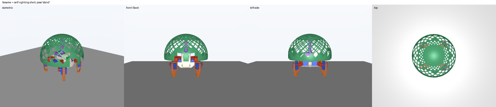

# Sesame 自己復帰甲羅 — turtle-shell v1（試作設計・未印刷）

Sesame（上流 `dorianborian/sesame-robot`、v117脚／v121フレーム／Top-Cover-Enclosed-v117）に後付けする
**自己復帰用の甲羅**です。復帰専用の重りは付けません。甲羅の形状と、転倒後に脚を決まった姿勢へ畳む動作だけで
腹ばいに戻し、そこから通常どおり立ち上がります。

> **状態:** 解析とシミュレーションでは合格しています。印刷・実機試験はまだです。数値は上流CADから推定した質量に
> 基づいています。`NEEDS-HARDWARE` の項目（後述）を実測で置き換えるまでは試作扱いにしてください。



## 結論（数値）

| 項目 | 値 |
|---|---|
| 甲羅（**一体版 `shell-onepiece.stl`**、標準） | 球殻 R = 90 mm・肉厚 1.2 mm・ひし形穴 183個に、マスト（Ø12）と上蓋用サドルが一体。外形 **180 × 180 × 103.2 mm**、PLAで約 **58.9 g** |
| 2部品版（`shell-dome.stl`＋`shell-mount.stl`） | 甲羅 47.7 g＋マウント 11.9 g。マストをソケットに差し込み、フィラメントのピンで固定 |
| 穴あけ治具（`drill-guide.stl`） | 一体版のネジ穴を上蓋にあけるための型。5.8 cm³ |
| 追加質量 | 58.9 g（ロボット推定 272.3 g → 331.2 g、+22 %） |
| 重心高さ（腹面基準） | 立ち姿勢 16.6 → 28.6 mm／畳み姿勢 18.9 → 30.4 mm |
| 立った時の全高 | 約 167 mm（足裏から甲羅頂点まで） |
| 畳み姿勢での安定姿勢 | **腹ばいのみ**（重心を±3 mm、26方向にずらしても同じ） |
| MuJoCo ランダム落下（畳み姿勢、120方向＋完全仰向け2件） | **122/122** が腹ばいで停止 |
| MuJoCo 転倒→畳む→受動復帰→起立（8姿勢） | **8/8** 成功（1件あたり 9.4 s） |
| 畳まずに甲羅だけの場合（立ち姿勢のまま） | 6/8 復帰。斜め横転の2件は 58° 傾いた状態で停止 |

## V3頭アーム版（最新・印刷用）— `stl/v3headarms/`

甲羅を**頭カバーの左右から生やしたアーム**で支え、**ひねって留める**版です（ネジなし）。クラウン・ふたの加工・キーはなくなり、
ふたはキットのものをそのまま使います。頭カバーは四隅のネジでフレームに留まっているので、甲羅の力はそのままフレームへ流れます。
パラメータは `params-v3headarms.json`、検証結果は `build/v3headarms/report.json` と `build/v3headarms/fit_check.json`、
プレビューは `preview/v3headarms/` です。

**印刷（プレート2枚、`stl/v3headarms/plates/`）**

| プレート | 中身 | 設定 |
|---|---|---|
| `plate1-shell-dome.3mf` | 甲羅だけ（`shell-dome-print.stl`：膝スロット4か所に印刷用の膜付き） | **ツリーサポートあり（ビルドプレートからのみ）**。PLA可、積層0.16 mm以下、壁ループ4、ブリム10 mm。甲羅約83 g＋膜約7 g。刷ったら膜をスロットの縁に沿ってカッターで切り取る |
| `plate2-body-head-mount.3mf` | 新しい頭（`head-mount`）・フレーム・底カバー・キットのふた・スペーサー4個 | 頭は縁を下（キットと同じ）で**サポートあり**（ビルドプレートからのみで可）。アームの下面と、先端の溝（高さ3.2 mmのすき間）の天井にサポートが付くので、溝の中のサポートはきれいに取ってください。アームは約17 g |

- 甲羅は肉厚1.6 mm・桟の最小幅5 mmです（2026-11-17、1.3 mm／4 mmのPLA印刷がスパゲッティになったため）。膝スロットの間の4枚の「花びら」が刷っている途中でしならないよう、スロットを厚さ0.8 mmの膜でふさいだ `shell-dome-print.stl` を刷ります。膜は機能部ではないので、質量計算と判定は膜なしの `shell-dome.stl` で行っています。
- `head-mount.stl` はキットの `head-cover` にアームを足したものです。**キットの頭カバーの代わりに刷ります**（ふたのレール・OLEDの窓・耳・ネジ穴はキットと同じ）。
- アームは層に沿って伸びる向き（水平）に刷られるので、曲げに強い向きです。

**仕組み**
- 左右のアームは、前脚と後脚の間の「脚が来ない通り道」（|x| ≤ 10 mm）を通り、甲羅の縁の少し内側まで伸びています。
  付け根はサーボのリボンケーブル（頭の横の切り欠きから入る）より上にあります。
- アームの先端は横向きに開いたコの字の溝です（下が受け、上が爪、一方の端が止め壁、開いた側の近くに小さな突起）。
- 甲羅の縁の内側には、左右にブロック（ラグ）が1つずつあります。縁と同じ高さから始まるので、ベッドの上で刷れます。

**組立・取り外し**
1. フレームに新しい頭（`head-mount`）を付け、キットのふたを差し込みます（キットの手順どおり）。
2. 甲羅を、**上から見て時計回りに9°ずらした向き**で、立ち姿勢のロボットに上からかぶせます（ラグがアーム先端の横に下ります）。
3. 縁を持って**反時計回りに9°ひねる**と、ラグが溝に入り、突起を越えてカチッと鳴り、止め壁で止まります。
4. 外すときは逆に、時計回りにひねって（突起を越えるので少し力が要ります）持ち上げます。

**デジタルツインでの検証結果（すべて合格）**

| 項目 | 結果 |
|---|---|
| 止まれる姿勢（畳み姿勢） | 腹ばいのみ。重心を±3 mmずらしても浅い止まり方の深さは最大0.11 mm（基準0.2 mm） |
| MuJoCo | 落下122/122、重心ずらし落下も全方向100 %、転倒→畳む→戻る→立つ 8/8、畳まない場合は5/8（肉厚1.3 mm版は6/8） |
| 重心 | 畳み姿勢で腹面から34.5 mm（肉厚1.3 mm版32.3 mm、クラウン版35.4 mm） |
| 脚とのすき間 | 歩行範囲6.7 mm、畳み動作6.5 mm。アームと脚は、股 −10°（walk）を含めて7 mm以上 |
| リボンケーブル | アームとリボンの経路のすき間3.1 mm |
| 甲羅のはめ込み | ずらした向きで下ろすと干渉0。ひねる途中は突起だけが0.74 mm当たる（カチッ） |
| 固定 | 持ち上げると0.4 mmで爪に掛かる。押し込むと0.2 mmで受けに当たる。回転は止め壁側0.2°、突起側0.3°で止まる |
| かぶせる・ひねるときの脚 | ずらした向き・ひねる途中・最後の向きのどれでも、立ち姿勢の脚から7.4 mm以上 |
| ふた | キットの頭と同じはまり具合（干渉0） |
| 印刷 | 甲羅（膜付きも）は浮動領域なし、水平に近い下向き面9 mm²（天辺の丸み）。頭は下向き面が約1450 mm²あり、サポート前提 |

**まだ実物で確かめていないこと（NEEDS-HARDWARE）**
- ひねりの硬さ（突起0.74 mmを縁のたわみで越える前提）。固すぎ・緩すぎは `params-v3headarms.json` の `head_arms.detent.protrude` で調整します。
- 溝の中のサポートの取りやすさと、受け・爪の面の仕上がり。
- 落としたときにアームの付け根（頭の側壁）が持つか。

**再生成・検証**
```sh
uv run python -I bambu/scripts/design.py     --params bambu/params-v3headarms.json   # 約15 s
uv run python -I bambu/scripts/analyze.py    --params bambu/params-v3headarms.json   # 約5分
uv run python -I bambu/scripts/fit_check.py  --params bambu/params-v3headarms.json   # 約10分
uv run python -I bambu/scripts/previews.py   --params bambu/params-v3headarms.json
uv run python -I bambu/scripts/make_plates.py --variant v3-headarms
```

## V3ネジなし版（クラウン版）— `stl/v3crown/`

V3キット（フレーム・頭カバー・ふた）向けの版です。下の「V3機体版」で出た問題（脚が当たる、大きい、固定が不安定、
膜が弱い、サポートで壊れる）を直しました。パラメータは `params-v3crown.json`、検証結果は `build/v3crown/report.json` と
`build/v3crown/fit_check.json`、プレビューは `preview/v3crown/` です。

**印刷のしかた（プレート2枚。どれもサポート不要）**

甲羅と支柱は、**必ず別々のプレートで**刷ってください。1枚に入れ子で並べた版（旧 `plate1-new-parts.3mf`）は、
支柱が倒れて甲羅を巻き込み、プレートごと失敗しました（2026-11-12）。

| プレート（`stl/v3crown/plates/`） | 中身 | 設定 |
|---|---|---|
| `plate1a-shell-dome.3mf` | 甲羅だけ | **PETG推奨**。**積層0.16 mm以下**（天辺の内側が30°）、壁ループ3以上、**ブリム10 mm**、ベッドにスティックのり。約68 g、外径188 × 188 × 126 mm |
| `plate1b-crown-lid-key.3mf` | 支柱（添え輪付き）・ふた・キー | 積層0.16 mm、**壁生成「Arachne」**（支柱の壁は水平0.71 mm。2本の細い線で刷らせる）、ブリム5 mm。支柱は約13 g＋添え輪約22 g |

- **支柱の形（2026-11-13 変更）**：以前は窓が8つあり、円錐が幅4 mm・厚さ0.6 mmの柱8本になっていました。柱がしなって
  スパゲッティになったため、窓をなくして**つながった45°の円錐**にしました（毎層が閉じた輪になります）。
  プレビューで高さ20〜40 mmの層を見て、支柱の壁が途切れずに一周していることを確かめてから刷ってください。
- **支柱の添え輪**：支柱は足元（直径40 mm）が細く、上の輪（幅134 mm）が重い形です。`crown-print.stl` は、輪の下面を
  支える薄い円筒（直径130 mm・高さ48 mm）を付けた印刷用の形です。円筒と支柱は0.7 mm離れていて、12本の細い爪だけで
  つながっています。刷り終わったら爪をニッパーで切るか折って、円筒を**下へ**抜いてください。輪の下面に爪の跡が
  少し残るので、出っ張っていれば削ります。`crown.stl` は添え輪なしの完成形です（確認用。刷るのは `crown-print.stl`）。
- 先に甲羅だけ確かめたいときは、プレート1aを高さ40 mmで止めると、縁の定着と反りを短時間で確認できます。

| 部品ファイル | 置き方 | 質量（PLA換算） |
|---|---|---|
| `stl/v3crown/shell-dome.stl` | 縁を下（STLのまま） | 約68 g |
| `stl/v3crown/crown-print.stl` | ツメを下（STLのまま） | 約13 g＋添え輪約22 g |
| `stl/v3crown/head-lid.stl` | 外側の面を下（キットと同じ。STLのまま） | 約8 g。キットの `head-lid-print.stl` の代わり |
| `stl/v3crown/lid-key.stl` | 平置き（STLのまま） | 0.2 g |

キットのフレーム・底カバー・頭カバー・スペーサーはそのまま使います（キットの `head-lid` は使いません）。
**フレームはV3キットのものが必要です**（頭カバーとふたのレールがV3専用のため）。

**仕組み（ネジなし）**
- ふた（`head-lid`）は、キットのふたと同じレールで後ろから差し込みます。形はキットのふたに、穴と切り欠きを加えただけです。
- ふたの右後ろの角穴に**キー**を上から押し込みます（先が二股で、パチッとはまります）。キーの先が頭カバー後ろのパネル内側に
  掛かり、ふたが後ろへ抜けなくなります。外すときはキーを引き抜きます。
- **支柱**（45°の傘形）は、下端のツメ3本をふたの穴の切り欠きに合わせて差し込み、**上から見て反時計回りに60°ひねる**と
  ロックされます。ツメはふたの厚みの中に収まり、ふたの裏に出ません（キットのサーボ配線経路から2.2 mm）。
- **甲羅**は、左右の窓を支柱の左右の爪に合わせて上からかぶせると、カチッと留まります。支柱の上端の輪に載る形です。
  外すときは、左右の窓から爪を内側へ押しながら持ち上げます。
- 甲羅の天辺は30°の円錐、穴の上辺は45°、窓や膝スロットの天井も尖らせてあるので、どの部品もサポートなしで刷れます。

**組立**
1. フレームにV3の頭カバーを付けます（キットの手順どおり）。
2. `head-lid` を後ろから奥まで差し込み、`lid-key` を角穴に押し込みます。
3. `crown` のツメを切り欠きに合わせて差し込み、反時計回りに60°ひねります（爪が左右を向く位置）。
4. `shell-dome` の窓を左右に合わせて、上からかぶせます。

**デジタルツインでの検証結果（すべて合格）**

| 項目 | 結果 |
|---|---|
| 止まれる姿勢（畳み姿勢） | 腹ばいのみ。重心を±3 mmずらすと浅い止まり方が出るが、深さは最大0.09 mm（基準0.2 mm、腹ばいは約14 mm） |
| MuJoCo | 落下122/122。重心を26方向に±3 mmずらした落下も全方向100 %。転倒→畳む→戻る→立つ 8/8。畳まない場合は5/8 |
| 脚とのすき間 | 歩行範囲で最小6.6 mm、畳み動作で6.5 mm、walk/turnで7.2 mm以上（前回は3 mm基準） |
| ふたのレール | キットのふたと同じはまり具合（干渉0 mm） |
| 支柱のロック | 差し込みもひねりも干渉なし。持ち上げると0.4 mmで引っかかる |
| キー | 0.5 mm後ろへ動いたところで止まる |
| 甲羅のスナップ | 干渉なし。持ち上げると0.7 mmで引っかかる。かぶせるときの爪のたわみは1.3 mm（ひずみ約1.4 %） |
| かぶせるときの脚 | 立ち姿勢のまま上からかぶせても、最小7.4 mm離れている |
| 印刷 | 水平に近い下向き面：甲羅10 mm²（天辺の丸み）、支柱34 mm²（爪の小さな返し）、ふた・キー0 |

**前の版からの変更点と理由**
- **甲羅の膜（0.3 mm）をやめ、穴を貫通**させました（0.3 mmはノズル幅より細く、刷れずに割れたため）。肉厚は1.2 → 1.4 mm、桟は2.8 → 4.0 mm以上です。
- **天辺を傾き30°の円錐**にしました。内側のサポートが要らなくなります。そのぶん背は少し高くなりました（頂点は腹面から160 mm）。
- **縁を33 → 34.5 mmに上げ**、膝スロットの余裕を4 → 6.5 mmにしました。歩行中、足の上端が縁の真下4.8 mmまで来ていたためです。
- 外径は196 → 188 mmで、R = 94、e = 18 です。重い膜と下側のブラケットをなくし、上の部品を軽くして重心を下げたので、小さくできました。
- 止まれる姿勢の判定は、「腹ばい以外の止まり方は、抜け出すのに重心を0.2 mm上げれば済む浅いものだけ」を合格に変えました。
  ただし、重心をずらした落下試験で実際に止まらないことを、MuJoCoで別に確かめています。

**まだ実物で確かめていないこと（NEEDS-HARDWARE）**
- 30°の天辺が、使うプリンター・材料でサポートなしで刷れるか。不安なら、スライサーのオーバーハング表示で確認してください。
- ふたの穴の加工がキットのふたのレールに影響しないか（加工は中央部だけですが、実際に滑らせて確認してください）。
- ツメ・爪・キーのはまり具合（すき間0.1〜0.4 mm）。きつい・ゆるい場合は `params-v3crown.json` の `clear`・`gap` で調整できます。
- 電子部品と電池の質量（推定値）。

**再生成・検証**
```sh
uv run python -I bambu/scripts/design.py    --params bambu/params-v3crown.json   # 約20 s
uv run python -I bambu/scripts/analyze.py   --params bambu/params-v3crown.json   # 約100 s（重心をずらした落下試験を含む）
uv run python -I bambu/scripts/fit_check.py --params bambu/params-v3crown.json   # 約6分（組付け経路・印刷性）
uv run python -I bambu/scripts/previews.py  --params bambu/params-v3crown.json
uv run python -I bambu/scripts/quick_screen.py --params bambu/params-v3crown.json --R 92 94 96 --e 16 18 20 --cap 30  # 大きさの当たりを付ける（CADなし、1点約10 s）
```

## V3機体版（`reference/frame-and-cover_261105`、ポールなし）— `stl/v3/`（旧版：膜0.3 mm・ネジ止め）

Loftwork V3 フレーム一式（フレーム・底カバー・頭部カバー・ふた。下の「S3ワイド機体版」の幅広フレームを置き換える）に合わせた版です。
**マスト（ポール）はありません。** 左右2本の `dome-bracket` をフレームに固定し、甲羅の縁の内側にある突起（ラグ）に下からネジで留めます。
甲羅のひし形の穴は貫通させず、**外側からのくぼみにして、内側に厚さ0.3 mmの膜を残しています**。
パラメータは `params-v3.json`、レポートは `build/v3/report.json`、プレビューは `preview/v3/` です。

| 項目 | 値 |
|---|---|
| 甲羅 `shell-dome.stl` | 球殻 R = **98 mm**、e = 20 mm、肉厚1.2 mm、くぼみ178個（膜0.3 mm）。外形 **196 × 196 × 117 mm**、約65 g。マストのソケットはなく、天頂はなめらか |
| ブラケット `dome-bracket-left/right.stl` | 各 23 × 60 × 7.5 mm、約4.6 g。底面が平らなので、そのまま置いてサポートなしで刷れる |
| ロボット（推定） | 364 g → 甲羅とブラケット込みで 438 g。畳み姿勢の重心は腹面から32.3 mm |
| 静的安定性 | 畳み姿勢で止まれるのは腹ばいだけ（重心を±3 mm・26方向にずらしても同じ）。盆地は100 %が腹ばい |
| MuJoCo | 落下122/122、転倒→畳む→戻る→立つ 8/8。畳まない場合は6/8 |
| すき間 | 歩行範囲で最小6.7 mm、畳み動作で4.0 mm、walk で4.8 mm（股 −10°を含む）。ブラケットと股サーボ本体のすき間は0.58 mm |
| サイズの根拠 | 静的判定だけの絞り込みで、R = 98・e = 20 は周りの R 96〜100、e 18〜22 もすべて合格。R = 94 は不合格、R = 96・e = 16 も不合格 |

**取り付けの仕組み**
- 前後の股サーボの間（|x| ≤ 11.6）には、脚が入ってきません。各ブラケットの足は、**股サーボの内側の耳2つ**
  （x = +8.94 と −9.31、|y| = 37.975）の上に載り、その耳のネジで一緒にフレームへ締めます。耳ネジは今より**3 mm長いもの**に替えてください。
- walk では右後脚の股が −10° まで動き、膝サーボが内側（|x| ≈ 10.4）へ入ってきます。そのため、足より外の柄と先端は幅10〜13 mmに細くしています。
- 甲羅の左右の縁の内側にはラグ（16 × 16 × 8 mm、底面は縁と同じ高さ）があり、Ø1.6・深さ6 mmの下穴が2つあいています。
  ブラケット先端の上面がラグの底に当たり、**下から M2 × 8 タッピングネジ2本**で締めます（ブラケット側にはØ4.4の座ぐり。ネジの座の厚さは3.5 mm）。

**組立**
1. 左右の股サーボの内側の耳ネジ（片側2本、計4本）を外し、ブラケットの足を耳の上に載せて、3 mm長いネジで締め直します。
2. 甲羅を上から被せ、ラグをブラケットの先端に合わせます。
3. 縁の下から、ドライバーで M2 × 8 を左右2本ずつ（計4本）締めます。

**印刷**
- 甲羅は縁を下にします。外面はくぼみだけなので、サポートは内側の天頂付近だけです（ツリー、ビルドプレートのみ）。
- **膜の0.3 mmはノズル幅（0.4 mm）より薄い**ので、スライサーで薄い壁が残るか確認してください（Bambu Studio の Arachne 壁生成、
  「薄い壁を検出」をON）。プレビューで、くぼみの底に1本線が出ていればOKです。
- ブラケットは置いたままの向きで、サポートは不要です。左右で別の部品です（鏡像）。

**未確定（NEEDS-HARDWARE）**
- 電子部品の質量（基板9 g、部品33 g）、電池47 g（キットの電池位置の箱で代用）、PLAの実効密度0.95は推定です。
- 脚はキットの股の位置まで平行移動して組み直しています。サーボのケース位置はキットの値と0.25 mmずれています。
  ブラケットと股サーボ本体のすき間0.58 mmは、実物で確認してください。
- 耳ネジの元の長さと種類は記録がありません（3 mm長いものを用意）。
- トリックの dance / point / cute / shrug は甲羅に当たります。wave は2.0 mmで、余裕が足りません。

**再生成**
```sh
uv run python -I bambu/scripts/design.py   --params bambu/params-v3.json    # 約15 s
uv run python -I bambu/scripts/analyze.py  --params bambu/params-v3.json    # 約90 s
uv run python -I bambu/scripts/previews.py --params bambu/params-v3.json
uv run python -I bambu/scripts/size_sweep.py --params bambu/params-v3.json --R 96 98 100 --e 20 --static-only
```

## S3ワイド機体版（`reference/frame-and-cover` の幅広フレーム用。V3キットで置き換えられた旧版）— `stl/s3-wide/`

教員が幅を14 mm広げたフレーム（左右に7 mmずつ。70 × 50 mmの基板を4 mmの柱に載せる）に合わせた版です。
上流の上蓋はこのフレームに付かないので、**新しい上蓋 `s3-top-cover`（マスト付き）を作り、その上に甲羅 `shell-dome` を差し込みます**。
パラメータは `params-s3wide.json`、レポートは `build/s3-wide/report.json`、プレビューは `preview/s3-wide/` です。

| 項目 | 値 |
|---|---|
| 甲羅 `shell-dome.stl` | 球殻 R = **94 mm**、e = 16 mm、肉厚1.2 mm、ひし形穴217個。外形 **188 × 188 × 110 mm**、約48 g |
| 上蓋 `s3-top-cover.stl` | 外形 72 × 52 × 112 mm（マスト込み）、約30 g。基板四隅のネジ穴（66 × 46.4 mm間隔）で留める |
| ロボット（推定） | 308 g → 甲羅と上蓋込みで 386 g。畳み姿勢の重心は腹面から33.0 mm |
| 静的安定性 | 畳み姿勢で止まれるのは腹ばいだけ（重心を±3 mm・26方向にずらしても同じ）。盆地は100 %が腹ばい |
| MuJoCo | 落下122/122、転倒→畳む→戻る→立つ 8/8。畳まない場合は6/8（斜め横転の2件は止まる。元の版と同じ） |
| すき間 | 歩行範囲と畳み動作で最小3.3 mm（大腿の根元と上蓋）。股サーボと上蓋は1.28 mm |
| サイズの根拠 | R = 90では、重心がずれると横の安定姿勢が残る。最小の合格はR = 92。ただし、電子部品の高さを46 mmにするとR = 92は不合格になり、R = 94は30〜46 mmのどれでも合格するのでR = 94にした |

**上蓋の形（大腿をよけるため）**：股90°（脚を前後に向けた状態）では、大腿が基板の長辺のすぐ外（|y| ≥ 26.1、Z 35〜40）を通ります。
そのため、Z 32〜43.7の帯では上蓋を |y| ≤ 22.7 に収めています。ここにあるのは前後の壁と四隅のネジ柱だけで、側面は開けてあります
（サーボの配線の出口）。全幅の箱と天井はその上にあります。後ろの壁にはUSBなどを通す開口（|y| ≤ 17、基板上20 mmまで）があります。

**組立**
1. 基板四隅のM1.6ネジ4本を外します。
2. 上蓋を基板の外周に被せます。天井の4つの穴からドライバー（PH0、Ø3.6の穴を通る細いもの）を入れ、**M1.6 × 8 のなべネジ**で、
   上蓋・基板・フレームの柱をまとめて締めます（床2.4 mm＋基板1.6 mm＋柱の下穴に約4 mm）。
3. 甲羅のソケットをマストに差し込みます。天頂から約27°の前（+X）の穴から、1.75 mmのフィラメントをピンとして通します（2部品版と同じ）。

**印刷**：甲羅は2部品版と同じ設定です。上蓋は四隅の脚を下にして置き、天井の下はツリーサポート（ビルドプレートから）にします。
脚の接地面は計131 mm²しかないので、ブリム5 mmを付けてください。

**未確定（NEEDS-HARDWARE）**
- **電子部品の高さ（基板上面から、サーボのコネクタと配線を含めた最上部まで）は暫定で38 mm**です。実測したら
  `params-s3wide.json` の `body.electronics_height_above_pcb_mm` と、`carrier-components` の高さ（`size_mm` の3番目）を書き換えて
  再生成してください。天井の高さとマストの長さが自動で追従します。
- 電子部品の配置は分かっていません（`Sesame-S3-Assembly.FCStd` はGit LFSにあり、手元にありません）。基板の四隅の穴のまわり
  **半径3 mm以内で、天井の高さまで**部品や配線がないことが前提です。
- 電子部品の質量は推定（基板9 g、部品33 g）、電池は47 gでフレームの中にある前提です。OLED（顔）の取付け位置は未定で、上蓋には窓がありません。
- トリックの dance / point / cute は甲羅に当たります（元の版と同じ）。

**再生成**
```sh
uv run python -I bambu/scripts/design.py   --params bambu/params-s3wide.json   # 約15 s
uv run python -I bambu/scripts/analyze.py  --params bambu/params-s3wide.json   # 約90 s
uv run python -I bambu/scripts/previews.py --params bambu/params-s3wide.json
uv run python -I bambu/scripts/size_sweep.py --params bambu/params-s3wide.json --R 92 94 --e 16   # 任意
```

## 要件との対応

| 要件 | 対応 | 根拠（`build/report.json`） |
|---|---|---|
| 復帰専用の重りを追加しない | 重りなし。甲羅とマウントはどちらも構造部品 | `mass_g` |
| 非均質な機体全体を対象にする | 上流STEPの部品492点を個別に扱う。サーボ・電池・PLA・電装・配線の質量を部品ごとに置き、甲羅の自重による重心上昇も反復計算する | `body_mass_breakdown`、`design.json` |
| 歩行に必要な脚の可動域を妨げない | 股 0–90°・膝 0–90° の全格子（7.5°刻み）で最小すき間 **6.73 mm**。walk、walk_backward、turn_left、turn_right、stand、rest も全て ≥ 6.6 mm | `clearance.walking_rom`, `motions` |
| 復帰中、顔の画面と電子部品を床から守る | OLED・基板・スイッチ・電池・上蓋は、どの向きで床に接しても凸包の内側に入る。最小余裕は電子部品 29 mm、電池 7.7 mm、上蓋 27 mm（畳み姿勢） | `static.*.protection_margin_mm` |
| 取り付け可能で3Dプリントできる | 一体版は上蓋の平らな上面に被せ、外した上蓋の内側から縦にM2ネジ4本で留める。水密STLで、P1S/X1/A1の256 mmベッドに収まる | `stl/*.stl` |
| 優先1：甲羅だけで受動復帰 | 立ち姿勢のままでも6/8が復帰（仰向け、左右横倒し、前後、斜め仰向け） | `mujoco.passive_only_stand_pose` |
| 優先2：転倒検知後に脚を畳む | 畳み姿勢（股 q=90°、膝 q=−90°）では単安定で、どの向きからでも腹ばいに戻る | `static.tuck` |
| 優先3：接地できる向きに戻ったら脚を伸ばして立つ | 膝を下ろし、続けて股を45°へ戻す（通常の起立と同じ動き）。8/8で立ち姿勢になった | `mujoco.recovery` |
| 蹴る・揺するは使わない | 使っていない。畳む・伸ばすは膝のゆっくりした掃引だけ | `scripts/sim_check.py` の `SEQUENCE` |

## 設計の考え方

- **硬く平らな床の上では、剛体は凸包だけで床に触れます。** 静止できる向きは、重心 G から凸包へ垂線を下ろした足が
  その面の内側に入る面だけです。G から床までの距離 h(u) が極小になる向きと言い換えられます。
- **甲羅は、中心 C を重心の真上（e = 16 mm上）に置いた球面です。** G から球面までの距離は、腹側から頂点に向かって
  単調に増えます。そのため仰向けは不安定な最大点になり、極小は腹ばいだけになります（「起き上がり小法師」と同じ原理です）。
  ゴムボックの形そのものは再現していません。
- **膝サーボの取付タブ（腹面より約5 mm下）が、横転・前後転のときの支点になります。** 支点から甲羅の縁までの線が
  重心の外側を通らないと、そこで止まってしまいます。縁を低く（Z = 33 mm）大きく張り出させているのはこのためで、
  Z = 33 は水平にした下腿より上、大腿より外側の位置です。小さい甲羅で止まる仕組みはここにあります（下のサイズ比較）。
- **畳み姿勢は股 90°（脚を前後に向ける）＋膝 −90°（下腿を上へ）です。** 横倒しのとき、この下腿の掃引面は床と平行に
  なるので、脚で床を押しません。甲羅には下腿が通る4本のスロットがあり、凸包はスロットの上をまたぐので安定性は変わりません。
- **ひし形穴の大きさは重心までの距離で決まります。** 床が穴をまたぐと穴は平らな小面になり、その面が機体を支えては
  いけません。そのため、子午線方向の半対角を e·sin(θ − 重心誤差角) − 1.5 mm 以下にしています。頂点付近（約27°以内）は
  穴なしです。頂点に平らな面やネジ穴を作ると仰向けが安定してしまうので、頂点には何も付けていません。
- 甲羅が重いと重心が上がり、その結果さらに大きい甲羅が必要になります。そこで、質量 → 重心 → 球の中心 → 形状 の順に
  固定点に収束するまで反復しています（`scripts/design.py`）。

## サイズと安定性のトレードオフ（`scripts/size_sweep.py`）

縁高さ Z = 33 mm、重心誤差 ±3 mm の条件です。「腹ばい以外で最も深い安定面」が 0 であれば単安定です。

| R [mm] | e [mm] | 甲羅外形 [mm] | 甲羅 [g] | 腹ばい以外で最も深い安定面 | 落下試験 | 起立シーケンス |
|---|---|---|---|---|---|---|
| 74 | 16 | 148 × 84 | 35 | 14.8 mm | 89 % | 8/8 |
| 78 | 16 | 156 × 89 | 43 | 13.3 mm | 96 % | 8/8 |
| 82 | 16 | 164 × 94 | 40 | 10.5 mm | 99 % | 8/8 |
| 86 | 16 | 172 × 99 | 42 | 4.8 mm | 100 % | 8/8 |
| **90** | **16** | **180 × 103** | **48** | **0（単安定）** | **100 %** | **8/8** |

R ≤ 86 では、膝サーボのタブと縁で支えた横・前後の安定姿勢が残ります。その姿勢から起きるには追加の動作や外乱が要ります。

## ファイル

```
bambu/
  stl/shell-onepiece.stl, .step 一体版：甲羅＋マスト＋サドル（印刷向き：縁を下、ベッド上 Z=0）
  stl/drill-guide.stl, .step    一体版用の穴あけ治具（スカートを下）
  stl/shell-dome.stl, .step     2部品版の甲羅（縁を下）
  stl/shell-mount.stl, .step    2部品版のサドル＋マスト（スカートを下）
  stl/assembly/*.stl, .step     組立座標（mm、X前・Y左・Z上、腹面 Z=0）— 確認・CAD取り込み用
  stl/cad.json                  体積・重心・外形
  stl/test/test-dome-d100-*.stl 試し刷り用の縮小ドーム（直径100 mm・肉厚3 mm、穴の位置は厚さ1 mmの薄肉。下記）
  preview/*.png                 組立図・印刷部品・MuJoCo 復帰シーケンス
  params.json                   すべての設計値と暫定質量（ここを編集して再生成）
  scripts/                      抽出・設計・解析・シミュレーション
  vendor/sesame-robot/          上流リポジトリ（git clone、.gitignore 済み）
  build/                        中間生成物と report.json（.gitignore 済み）
```

## 印刷（Bambu Studio、PLA、0.4 mmノズル）

外形が180 mmなので P1S/X1/A1（256 mm）用です。A1 mini（180 mm）では余裕がありません。

**一体版 `shell-onepiece.stl`（標準）**
- 縁を下にしてそのまま配置します。プロセスは「0.20mm Standard」で十分です。壁ループ3（肉厚1.2 mmを外周だけで作る）、ブリム5 mm。
- サポートは「ツリー（自動）」、ビルドプレートのみON、閾値角度25〜30°にします。
- 付くべきサポートは2か所です。
  - ドーム内側の天頂付近（マストが中心を支えるので、そのまわりの輪の部分）
  - サドルのスカート下端（ベッドから14 mm浮いているため）
- **サドルの内側（上蓋が入る空洞）はサポートペイントでBlockしてください。** 空洞の天井は25 mmのブリッジでサポートなしで刷れます。内側にサポート痕が残ると嵌合が悪くなります。
- **外面にサポートを付けないでください。** 頂点まわりに継ぎ目・ブリム残り・サポート痕を残すと、仰向けで止まる原因になります。

**`drill-guide.stl`**：スカートを下にして配置します。サポート不要、数分で刷れます。まずこれで上蓋への嵌まり具合（すき間0.3 mm）を確かめてください。

**2部品版**：`shell-dome` は縁を下（サポートは一体版と同じ考え方）、`shell-mount` はスカートを下（サポート不要）にします。

印刷後に部品の質量を量り、`params.json` に反映して再生成してください（下記「再生成」）。

**試し刷り用の縮小ドーム `stl/test/`**（ロボットには付きません。ドームのみで、マスト・サドルはありません）
- 現行の甲羅（`build/job.json`）を直径100 mm（×0.556）に縮め、肉厚だけは縮めずに **3 mm** にしたものです。ひし形穴は貫通させず、
  **厚さ1 mmの薄肉**として残しています。下腿用のスロット4本は貫通のままです。外形 100 × 100 × 57.3 mm、体積 33.6 cm³（PLA 約42 g）。
- `-outer`：くぼみが外側（模様が外から見える。内面はなめらか）。外面にサポートが要らないので、縁を下にして刷るならこちらが楽です。
- `-inner`：くぼみが内側（外面はなめらかな球。転がり方を見るならこちら）。天頂付近の内側にサポートを付けるとくぼみに入り込みます。
- 再生成：`/Applications/FreeCAD.app/Contents/Resources/bin/python -I bambu/scripts/build_test_dome.py bambu/build/job.json bambu/stl/test`
  （`--diameter` `--thickness` `--skin` `--side outer|inner|both` で変更可）。

## 組立（一体版）

1. 上蓋をロボットから外します（フレーム下側のM2ネジ）。
2. `drill-guide` を上蓋の平らな上面に被せ、前端を耳の後ろに当てます。
3. 治具の4つの穴から、上蓋の天面（厚さ約1.3 mm）に **Ø2.2の通し穴** をあけます。穴は甲羅の中心軸のまわり半径8 mm、45°おきの4か所です。真下には何もないことを確認済みです。
4. 甲羅（一体版）のサドルを上蓋に被せます。外した上蓋を裏返し、**内側から M2×6 タッピングネジ4本を上向きに** 締めます（小さいワッシャーがあれば併用）。サドル側にはØ1.6の下穴、深さ5 mmがあります。
5. 甲羅付きの上蓋をロボットに戻し、フレーム下側から元のネジで留めます。
6. 電源を入れる前に、手で脚を歩行範囲・畳み姿勢まで動かし、甲羅に当たらないことを確認します。

**2部品版の場合**：サドルを上蓋に被せ、側面の4穴（Ø2.2、X = −18 / +6 mm、腹面から50.5 mm）から下穴Ø1.6をあけて M2×6 で横から留めます。
そのあと甲羅のソケットをマストに差し込み、正面（+X）の天頂から27°にあるひし形穴から 1.75 mmフィラメント（約45 mm）を差して
横穴（腹面から126.5 mm）を貫通させます。ピンの端は甲羅の外面より内側に収めてください。

## ファームウェア側に必要な動作（未実装）

**畳み姿勢と起立の手順（ファームウェア角度。manifest の `sign` から換算）**

| 段階 | R1 | R2 | L1 | L2 | R3 | R4 | L3 | L4 | 時間 |
|---|---|---|---|---|---|---|---|---|---|
| 転倒中（立ち姿勢を保持） | 135 | 45 | 45 | 135 | 180 | 0 | 0 | 180 | — |
| 畳む1：股を前後へ | 180 | 0 | 0 | 180 | 180 | 0 | 0 | 180 | 0.6 s |
| 畳む2：膝を上へ | 180 | 0 | 0 | 180 | **0** | **180** | **180** | **0** | 1.4 s（≤200 °/s） |
| 受動復帰を待つ | 同上 | | | | | | | | 2.5 s |
| 起立1：膝を下ろす | 180 | 0 | 0 | 180 | 180 | 0 | 0 | 180 | 1.6 s |
| 起立2：股を立ち姿勢へ | 135 | 45 | 45 | 135 | 180 | 0 | 0 | 180 | 0.8 s |

- 実機への指令は必ず SafeAction 層を通してください（速度制限・ウォッチドッグ・停止）。現在の S3 プロファイルの初期制限
  `[85, 95]°` のままでは畳み姿勢に届きません。校正（sweep → verify → save）を済ませ、可動域を広げてから行ってください。
- **転倒検知にはIMUが要ります。** 現行の上流構成にも S3 構成にもIMUは載っていません（`NEEDS-HARDWARE`）。
  当面は、手動コマンドで上の手順を実行して試験してください。
- 甲羅を付けている間は、トリックの **dance / point / cute** を使わないでください。下腿が水平より上がり、甲羅に当たります
  （`clearance.motions`）。wave / freaky / worm / shrug は 3.9 mm 以上離れているので使えます。

## 実機試験の手順（暫定の判定値）

- 床：硬く平らで水平な机（MDF・化粧板など）。周囲 40 cm 以内に障害物を置かない
- 初期姿勢：仰向け、左横、右横、前のめり、後ろのめり、斜め仰向け、左横＋前45°、右横＋後45°、それに完全仰向け（そっと置く）
- 回数：各10回（計90回）。判定は「人の介助なしで立ち姿勢（傾き < 10°）に戻る」、時間制限は 10 s
- 目標成功率：95 %以上（暫定。決定権は教員）。「完全仰向けから外乱なしで動き出すか」は別に記録します。理論上は不安定な
  釣り合いで、シミュレーションでは数値誤差で倒れました。実機で止まった場合は「畳み動作の振動で抜ける」ことを制約として記録してください
- 記録：開始姿勢、成功/失敗、停止した姿勢の写真、所要時間、破損の有無、甲羅とマウントの実測質量

## 未検証・要実測（NEEDS-HARDWARE）

- 質量はすべて推定値です（サーボ 13.4 g、電池 40 g、PLA実効密度 0.95 g/cm³）。完成機の総質量と重心を量ってください
  （2点支持のバランス法で ±1 mm 程度）。重心が設計値から3 mm以上ずれていたら再生成が必要です
- 形状は上流の ESP32 v122 STEP（SG90形状、立ち姿勢）を使っています。S3 SuperMini＋PCA9685 の実機で電装配置が違う場合は、
  `sesame_model.py` の質量を実測値に置き換えて再解析してください
- 関節の符号（manifest の `sign`）は manifest 上も「assumed」です。畳み姿勢は、甲羅を外した状態で1関節ずつ低速で確認してください
- サドルの嵌合（すき間 0.3 mm）は STL から計測した値です。まず `drill-guide` を刷って嵌まり具合を確認してください
- 別の機体（例：横幅5 cmのボディ）に付ける場合は、`params.json` の `mount.top_cover`（断面形状 `profile_yz`、平らな上面の前後範囲 `flat_x`）を新しい機体の値に置き換えて再生成してください。重心が変わる場合は質量も更新が必要です
- MuJoCo では各部品を凸包で扱い、床の摩擦係数は 0.6、サーボは 0.176 N·m（MG90S公称）でトルクを制限しています。
  脚と甲羅の衝突は幾何学的なすき間チェックで別途確認しています
- 静的安定性はSTLのテッセレーションによる微小な窪みを除外しています（深さ < 0.02 mm、最大 0.0003 mm）
- 歩行性能（+60 g・重心上昇によるサーボ負荷、転倒しやすさの変化）は未評価です

## 再生成

```sh
# 1. 上流を取得（初回のみ）
git clone --depth 1 https://github.com/dorianborian/sesame-robot.git bambu/vendor/sesame-robot
# 2. STEP → 部品メッシュ（FreeCAD 1.1 同梱 Python）
/Applications/FreeCAD.app/Contents/Resources/bin/python -I bambu/scripts/extract_upstream.py \
    bambu/vendor/sesame-robot/hardware/cad/Sesame-ESP32-v122.step bambu/build/upstream
# 3. 設計（params.json → stl/）。質量と重心が収束するまで反復
#    shell.variant = "one-piece"（標準）/ "two-piece" で解析対象を切り替え。STLは両方とも出力
uv run python -I bambu/scripts/design.py
# 4. 検証（静的・すき間・MuJoCo）。1件でも不合格なら終了コード 1
uv run python -I bambu/scripts/analyze.py
# 5. プレビュー、サイズ比較（任意、約7分）
uv run python -I bambu/scripts/previews.py
uv run python -I bambu/scripts/size_sweep.py
```

検証は macOS（FreeCAD 1.1.3、MuJoCo 3.10）でのみ実行しています。Linuxでは未確認です。
